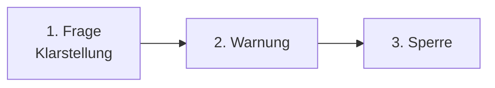

# Wirtschaft & Fair-Play-Regeln

Hier findest du die Regeln für Wirtschaft und Fair-Play in VoltFracht.

---

## 1. Was ist das Spielgeld?

Alle Währungen und Werte in VoltFracht sind virtuell und haben keinen
echten Geldwert:

* **Rein virtuell ("Spielgeld")**: Alle In-Game-Euro-Bestände ("€"), Coins
  (★), Fahrzeuge, Aufträge und Transportgüter sind streng virtuelle Punkte
  **ohne realen Geldwert**.
* **Keine Auszahlung in Echtgeld**: Virtuelle Euros und Coins können nicht in
  Bargeld umgewandelt, erstattet oder gegen reale Währung, gesetzliche
  Zahlungsmittel oder physische Güter eingetauscht werden.
* **Digitale Inhalte**: Optionale Käufe (wie z. B. VoltFracht PRO oder
  Coin-Pakete) gewähren sofortige digitale Nutzungsrechte. Gemäß Absatz 3 der
  AGB (§ 356(5) BGB) beginnt die Leistung sofort mit dem Kauf und es besteht
  kein Widerrufs- oder Rückgaberecht.

---

## 2. Fair-Play in der Wirtschaft

Damit alle gleich fair spielen können:

* **Kein Geldtausch**: Coins (★) können nicht in Euro (€) umgewandelt werden.
  So kann niemand sich Plätze in den Ranglisten kaufen.
  Regel seit 30. September 2026.
* **Depot-Limit**: Depotplätze ab Level 9 können nicht mehr mit Coins gekauft
  werden. Sie müssen mit echten Frachteinnahmen (€) bezahlt werden.
  Regel seit 30. September 2026.

**Warum?** Damals konnten Spieler mit Coins Ranglistenplätze kaufen.
Alle Buchungen wurden geprüft (79'000+ Transaktionen). Die Coin-Berechnungen
waren immer korrekt, nur der Tauschweg wurde entfernt.

---

## 3. Regeln für den Gebrauchtwagenmarkt

Damit niemand Geld zwischen Konten hin- und herschieben kann, gibt es
Schutzregeln auf dem Gebrauchtwagenmarkt (seit 26. September 2026):

| Regel | Limit | Zweck |
| :--- | :--- | :--- |
| **Level-Sperre** | Level 3 nötig | Verhindert, dass neue Konten sofort den Markt nutzen. |
| **Preisgrenzen** | Min: Sofortverkaufswert Max: 1,2× Neupreis | Verhindert Preise, die zu hoch oder zu niedrig sind. |
| **Handelslimit** | Max. 3 Geschäfte/Tag mit einem Partner | Verhindert ständiges Hin- und Herverkaufen. |

**Warum?** Einige Spieler haben neue Konten erstellt, Startgeld gesammelt,
LKWs vom Hauptkonto teuer gekauft und dann günstig zurückverkauft.
Diese Konten wurden gesperrt, das Geld zurückgebucht und aus den
Ranglisten entfernt.

---

## 4. Anti-Cheat-Regeln

Jeder muss selbst spielen. So sind alle Ranglistenplätze fair erreicht.

**Hinweis**: Mit Version 0.18 (18. Oktober 2026) gibt es neue Fair-Play-Regeln.
Alle müssen beim nächsten Login zustimmen. Die Regeln gelten ab dann.

### Du musst selbst spielen

Jede Aktion (Fracht auswählen, Route planen, Ladestopps setzen) musst du
selbst machen. Verboten sind:

* Automatisierte Skripte, Bots, Makros und Auto-Klicker.
* Zugriff auf Server-API außerhalb vom offiziellen Client.

**Warum?** Konten, die 24/7 ohne Pausen laufen, nutzen meist Bots oder
geteilte Zugangsdaten. Das ist nicht fair.

### Ein Konto = Ein Spieler

* Jedes Konto gehört nur einer Person.
* Du darfst dein Konto nicht mit anderen teilen oder Zugangsdaten weitergeben.

**Achtung:** Du kannst auf so vielen deinen eigenen Geräten spielen wie du
willst. Aber ein Konto darf nicht mehr leisten, als ein Mensch schaffen kann.

### Was passiert bei Verdacht?

Um Bots zu erkennen, speichert der Entwickler nur Zeitstempel (keine IP
oder Hardware-Daten) für 90 Tage. Das schützt deine Privatsphäre.

1. **Abfrage**: Spieler, die durch Bot-Aktivität auffallen (z. B.
   24/7-Betrieb ohne Pausen), erhalten zunächst eine direkte In-Game-Frage.
2. **Warnung**: Wenn du nach der Abfrage weiter Bots nutzt, gibt es eine
   offizielle Warnung.
3. **Sperre**: Bei weiteren Verstößen wird dein Konto gesperrt und aus den
   Ranglisten entfernt.

**Wichtig**: Kein Konto wird ohne vorherige Abfrage gesperrt. Die erste
Benachrichtigung, die du erhältst, ist eine Frage, keine Strafe.

---

## 5. Transparente Finanzen

Jede Transaktion in VoltFracht hat eine klare Buchungsquittung mit einer
Belegnummer. So kannst du Einnahmen, PRO-Boni und Coin-Verteilungen direkt
im Transaktionsprotokoll überprüfen.
