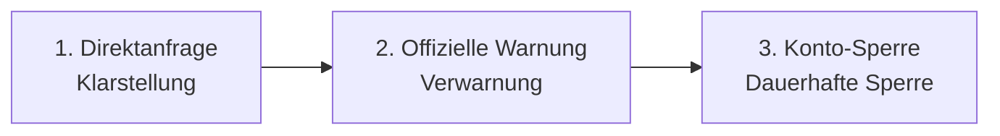

# Wirtschaft & Fair-Play-Richtlinien

Dieser Leitfaden erläutert die wirtschaftlichen Regeln, Anti-Cheat-Richtlinien
und die Allgemeinen Geschäftsbedingungen (AGB/T&C), die für VoltFracht gelten.

---

## 1. Rechtliche Natur der In-Game-Währung ("€" & Coins)

Absatz 2 der Allgemeinen Geschäftsbedingungen (AGB) von VoltFracht definiert
explizit den rechtlichen Status aller In-Game-Vermögenswerte und finanziellen
Salden:

* **Rein virtuell ("Spielgeld")**: Alle In-Game-Euro-Bestände ("€"), Coins
  (★), Fahrzeuge, Aufträge und Transportgüter sind streng virtuelle Punkte
  **ohne realen Geldwert**.
* **Keine Auszahlung in Echtgeld**: Virtuelle Euros und Coins können nicht in
  Bargeld umgewandelt, erstattet oder gegen reale Währung, gesetzliche
  Zahlungsmittel oder physische Güter eingetauscht werden.
* **Digitale Inhalte**: Optionale Käufe (wie z. B. VoltFracht PRO oder
  Coin-Pakete) gewähren sofortige digitale Nutzungsrechte. Gemäß Absatz 3 der
  AGB (§ 356(5) BGB) beginnt die Leistung sofort mit dem Kauf und es besteht
  kein Widerrufs- oder Rückgaberecht.

---

## 2. In-Game-Wirtschaft & Ranglisten-Balancierung

Um die Wettbewerbsintegrität in den internationalen Ranglisten zu wahren:

* **Keine Währungsumwandlung**: In-Game-Coins (★) können nicht in virtuelle
  Euro (€) umgewandelt werden. Implementiert am 30. September 2026, um
  Pay-to-Win-Ranglisten-Manipulation zu verhindern.
* **Depot-Aufwertungslimit**: Die Aufwertung der Depotkapazität mit Coins ist
  auf **Depot Level 8** begrenzt. Depotplätze ab Level 9 müssen durch erwirtschaftete
  Frachteinnahmen (€) finanziert werden, um Pay-to-Win-Vorteile in öffentlichen
  Ranglisten zu verhindern. Implementiert am 30. September 2026.

**Begründung**: Diese wirtschaftlichen Anpassungen wurden eingeführt, nachdem
Analysen ergaben, dass unbegrenzte Coin-zu-Euro-Umwandlungen und
Depot-Erweiterungen das Kauf von Ranglistenpositionen ermöglichten, anstatt
sie durch Spiel zu verdienen. Alle bestehenden Buchungen wurden überprüft
(79'000+ Transaktionen geprüft). Die Coin-Berechnungen waren immer korrekt;
nur der Umwandlungsweg wurde entfernt.

---

## 3. Anti-Missbrauch-Regeln für den Gebrauchtwagenmarkt

Um künstliche Geldtransfers zwischen Sekundärkonten zu verhindern, ist der
Handel auf dem Gebrauchtwagenmarkt durch automatisierte Schutzmaßnahmen
eingeschränkt (implementiert am 26. September 2026):

| Anti-Missbrauch-Regel | Durchsetzungslimit | Zweck |
| :--- | :--- | :--- |
| **Konto-Level-Sperre** | Level 3 erforderlich | Verhindert sofortige Wegwerfkonten-Erstellung zur Preisausnutzung. |
| **Preisgrenzen** | Min: Sofortverkaufswert Max: 1,2× Neupreis | Verhindert den Verkauf von Starter-LKWs zu Fantasiepreisen zur virtuellen Geldübertragung. Zuvor konnten Preise bis zum 10-fachen des Neupreises gesetzt werden. |
| **Tägliches Partnerlimit** | Max. 3 Geschäfte/Tag pro Handelspartner | Blockiert kontinuierliche Kreishandels-Schleifen zwischen verbundenen Konten. |

**Hintergrund**: Diese Regeln wurden nach der Entdeckung eines Ausnutzungsschemas
eingeführt, bei dem Spieler neue Konten erstellten, Startkapital sammelten,
Fahrzeuge von ihrem Hauptkonto zu überteuerten Preisen kauften, diese günstig
zurückverkauften und dann das temporäre Konto löschten. Die betroffenen Konten
wurden identifiziert, unrechtmäßig erwirtschaftete Gewinne zurückgebucht und die
Konten aus den Top-Ranglisten entfernt. Hauptkonto und 21 Wegwerfkonten wurden
gesperrt.

---

## 4. Allgemeine Geschäftsbedingungen (AGB) & Anti-Cheat-Richtlinien

VoltFracht setzt klare Fair-Play-Richtlinien durch, um sicherzustellen, dass
alle Ranglistenplatzierungen echtes menschliches Dispatching-Fachwissen widerspiegeln.

**Hinweis**: Mit Version 0.18 (veröffentlicht am 18. Oktober 2026) wurde ein
neuer Fair-Play-Abschnitt zu den AGB hinzugefügt, der alle Spieler beim
nächsten Login zur Zustimmung auffordert. Diese Regeln gelten ab dem Datum
der Zustimmung, **nicht rückwirkend**.

### Das "Du spielst selbst"-Prinzip

Jede Dispatching-Aktion, einschließlich der Auswahl von Fracht, Routenplanung
und Festlegung von Ladestopps, muss manuell vom Kontoinhaber ausgelöst werden.
Verboten sind:

* Automatisierte Skripte, Bots, Makros und Auto-Klicker.
* Zugriff auf die Server-API außerhalb des offiziellen Web-/Mobile-Clients.

**Begründung**: Die Analyse der Ranglistendaten durch den Entwickler zeigte
Konten, die 24/7 ohne Pausen operierten, was auf geteilte Zugangsdaten oder
automatisierte Skripte hindeutet. Beide verstoßen gegen den Geist des fairen
Wettbewerbs.

### Kontobesitz

* **Einzelbenutzerbesitz**: Konten gehören streng genommen einer einzelnen Person.
* **Verbotenes Teilen**: Das Teilen von Konten, gemeinsames Spielen durch mehrere
  Personen sowie Verkaufen, Vermieten oder Übertragen von Zugangsdaten ist
  verboten.

**Klarstellung**: Diese Regeln schränken nicht ein, wie oft Sie spielen oder
auf wie vielen Ihrer eigenen Geräte Sie auf Ihr Konto zugreifen. Sie verbieten
nur, dass ein einzelnes Konto mehr leistet, als ein Mensch vernünftigerweise
bewältigen kann.

### Prüf- und Streitverfahren

Um Konten mit rund um die Uhr automatisierten Aktivitäten fair zu erkennen,
protokolliert der Entwickler **nur Zeitstempel** (ohne IP- oder Hardware-Tracking)
für **90 Tage** in Übereinstimmung mit der Datenschutzrichtlinie.

1. **Abfrage**: Spieler, die durch unköziperliche Aktivität auffallen (z. B.
   24/7-Betrieb ohne Pausen), erhalten zunächst eine direkte In-Game-Klarstellungsfrage.
2. **Warnung**: Fortgesetzte nicht verifizierte Automatisierung nach der Abfrage
   führt zu einer offiziellen Warnung.
3. **Sperre**: beharrliche Verstöße führen zur Kontosperre und Entfernung aus
den Ranglisten.

**Wichtig**: Kein Konto wird ohne vorherige Abfrage gesperrt. Die erste
Benachrichtigung, die Sie erhalten, ist eine Frage, keine Strafe.

---

## 5. Finanzielle Transparenz & Belegnummern

Jede finanzielle Transaktion in VoltFracht generiert eine detaillierte
Buchungsquittung mit einer eindeutigen Belegnummer, die es Disponenten
ermöglicht, Einnahmen, PRO-Boni und Coin-Verteilungen direkt im
Transaktionsprotokoll zu überprüfen. Dieses System unterstützt den
Fair-Play-Prüfprozess durch berechenbare Finanzaufzeichnungen.
