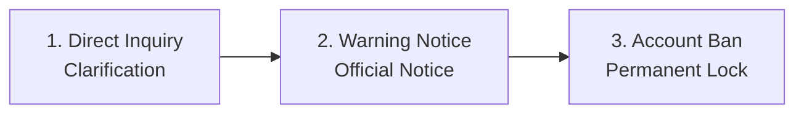

# Economy & Fair-Play Guidelines

This guide details the economic rules, anti-cheat policies, and Terms of
Service (TOS / AGB) governing VoltFracht.

---

## 1. Legal Nature of In-Game Currency ("€" & Coins)

Section 2 of the VoltFracht Terms & Conditions (T&C) explicitly defines the
legal status of all in-game assets and financial balances:

* **Purely Virtual ("Funny Money")**: All in-game Euro balances ("€"), Coins
  (★), vehicles, orders, and haulage assets are strictly virtual points with
  **no real monetary value**.
* **No Real-World Payouts**: Virtual Euros and Coins cannot be cashed out,
  refunded, or exchanged for real-world currency, legal tender, or physical
  goods.
* **Digital Content Terms**: Optional purchases (such as VoltFracht PRO or
  Coin packages) grant immediate digital usage rights. Per Section 3 of the
  TOS (§ 356(5) BGB), performance begins immediately upon purchase and holds
  no right of withdrawal or cash conversion.

---

## 2. In-Game Economy & Score Balancing

To maintain competitive integrity across international leaderboards:

* **No Currency Conversion**: In-game Coins (★) cannot be converted into
  virtual Euro (€) cash balance.
* **Depot Upgrade Cap**: Upgrading depot capacity via Coins is capped at
  Depot Level 8. Higher depot levels must be funded through earned freight
  revenue to prevent pay-to-win advantages on public rankings.

---

## 3. Used Truck Marketplace Anti-Abuse Rules

To stop artificial money transfers between secondary accounts, trading on the
used truck marketplace is restricted by automated safeguards:

| Anti-Abuse Rule | Enforcement Limit | Purpose |
| :--- | :--- | :--- |
| **Account Level Gate** | Level 3 required | Prevents instant throwaway account creation for price exploitation. |
| **Price Bounds** | Min: Instant-sell value Max: 1.2× new vehicle price | Prevents selling starter trucks at fantasy prices to transfer virtual cash. |
| **Daily Partner Cap** | Max 3 trades/day per trading partner | Blocks continuous circular trading loops between affiliated accounts. |

---

## 4. Terms of Service (AGB) & Anti-Cheat Policies

VoltFracht enforces clear fair-play guidelines to ensure all leaderboard
rankings reflect genuine human dispatching skill:

### The "You Play Yourself" Principle

Every dispatch action, including selecting cargo, routing trucks, and setting
charging stops, must be manually initiated by the account owner.
Prohibited automation tools include:

* Automated scripts, bots, macros, and auto-clickers.
* Interfacing with the server API outside the official web/mobile client.

### Account Ownership

* **Single-User Ownership**: Accounts belong strictly to a single individual.
* **Prohibited Sharing**: Account sharing, joint multi-person play, renting,
  selling, or transferring credentials is forbidden.

### Audit & Dispute Procedure

To catch round-the-clock automated accounts fairly, the developer logs action
timestamps (without IP or hardware tracking) for 90 days:

1. **Inquiry**: Players flagged for inhuman activity receive a direct in-game
   clarification question first.
2. **Warning**: Continued unverified automation results in a formal warning.
3. **Ban**: Persistent violations lead to account suspension and removal from
   leaderboard rankings.

---

## 5. Financial Transparency & Receipt Tracking

Every financial transaction in VoltFracht generates an itemized booking
receipt with a unique receipt number, allowing dispatchers to verify income,
PRO bonus additions, and coin distributions directly in the transaction log.
