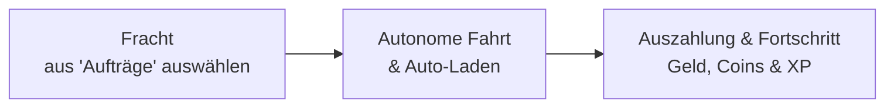

# Erste-Schritte-Anleitung

Willkommen bei **VoltFracht**, einem elektrischen Frachtdispatching- und
Logistikmanagement-Simulationsspiel, das von Solo-Indie-Entwickler
**Sebastian Giove** entwickelt wurde. Bei VoltFracht agierst du als
Unternehmensdisponent. Du wählst die Fracht, wählst Routenstrategien aus und
verwaltest die Flottenexpansion in ganz Europa, während deine autonomen
E-LKWs das Fahren und die Ladeplanung übernehmen.

---

## 1. Plattformverfügbarkeit & Kontosystem

VoltFracht ist für nahtloses plattformübergreifendes Spielen auf Desktop-
und Mobilgeräten konzipiert:

* **Webbrowser**: Spiele direkt unter
  [voltfracht.sgio.app](https://voltfracht.sgio.app/) ohne Installation.
  Der Web-Client erhält sofort Spielupdates.
* **iOS / iPadOS**: Verfügbar im Apple App Store für iPhone und iPad
  (erfordert iOS 15.0 oder neuer).
* **Android**: Verfügbar im Google Play Store.
* **Kontosynchronisation**: Ein einziges Konto (Google-, Apple- oder
  E-Mail-Login) synchronisiert deine Flotte, dein Kapital und deinen
  Fortschritt nahtlos zwischen Browser und mobilen Apps. Du kannst auch
  sofort als Gast ohne Kontoerstellung starten.
* **Monetarisierung & Datenschutz**: VoltFracht ist komplett kostenlos.
  Fortschritt ist freiwillig. Optionale Coin-Pakete und ein PRO-Abo
  (€4,99/Monat) sind verfügbar. Das Spiel sammelt keine persönlichen
  Benutzerdaten von Mobilclients.

---

## 2. Onboarding & Auswahl des Heimatdepots

Beim Start deines Unternehmens wählst du eine Heimatdepot-Stadt und ein
Heimatland:

### Die Nachbarländer-Regel

In VoltFracht gewährt das Freischalten eines Landes automatisch operativen
Zugang zu diesem Land **plus allen direkt angrenzenden Nachbarländern**.

!!! tip "Optimaler Startstandort: Deutschland"
    Bei der Wahl deines Start-Heimatdepots gilt **Deutschland** als mit Abstand
    die beste Wahl. Da Deutschland Grenzen mit **9 Nachbarländern** teilt
    (Dänemark, Polen, Tschechische Republik, Österreich, Schweiz, Frankreich,
    Luxemburg, Belgien und Niederlande), gewährt die Auswahl eines deutschen
    Heimatdepots sofortigen Zugang zu 10 europäischen Nationen ab Tag eins,
    ohne Coins oder Kapital für neue Grenzen ausgeben zu müssen.

---

## 3. Erste Schritte & Startkapital-Strategie

### Startstrategie: Nicht warten!

Dein Unternehmen beginnt mit einem einzelnen 7,5-Tonner-E-LKW in deinem
Heimatdepot und einem Startgeldbetrag.

!!! tip "Empfehlung des Entwicklers"
    Warte nicht untätig, bis dein erster LKW seine Fahrt beendet hat! Nutze dein
    Startkapital sofort, um einen 2. oder 3. 7,5t-LKW zu kaufen. Mehrere aktive
    Fahrzeuge von Anfang an beschleunigen den Geldfluss und steigern dein
    Unternehmen viel schneller.

### Anfängerbonus (+10 %)

Alle neu registrierten Unternehmen erhalten einen **+10 %-Anfängerbonus** auf
den Basisauszahlung jedes abgeschlossenen Auftrags für ihre **ersten 7 Tage**.
Dieser Bonus wird automatisch zu den Auszahlungen addiert und in deinen
Finanzprotokollen aufgeschlüsselt.

### Leveln & Depot-Erweiterung

* **Unternehmens-Leveln**: Der Kauf zusätzlicher Depot-Stellplätze erhöht dein
  Unternehmenslevel (z. B. die Ausgabe von €250'000 für einen 2.
  Depot-Stellplatz erhöht dein Konto auf Level 2).
* **Depot-Stellplätze**: Die Depotkapazität begrenzt die Anzahl aktiver,
  dispatchbarer LKWs. Nicht benötigte Fahrzeuge können in **der
  [Halle](../fleet/depot-hall.md)** eingelagert werden, um Depot-Stellplätze
  freizugeben, ohne sie zu verkaufen.

---

## 4. Grundlagen des Dispatching-Prozesses

1. **Fracht auswählen**: Öffne die **Aufträge**, filtere nach Tonnageklasse
   oder Frachttyp und bewerten die Auszahlung im Verhältnis zur Route-Distanz.
2. **LKW entsenden**: Sobald zugewiesen, navigiert der LKW autonom durch
   reale Straßennetzwerke und berechnet erforderliche Ladestopps basierend auf
   Nutzlast und Batteriekapazität.
3. **Auszahlungen einsammeln**: Bei Ankunft erhält dein Konto die
   Frachtauszahlung, Coins und Erfahrungspunkte. Investiere die Einnahmen
   in neue LKW-Modelle, höhere Tonnage-Lizenzen oder Depot-Erweiterungen.

---

## 5. Echtzeit-Daten-Engine

VoltFracht integriert **authentische europäische geografische,
infrastrukturelle und wirtschaftliche Datenströme** direkt in seinen
Kernspielkreis. Jede Lieferberechnung, jeder Batterieverbrauch und jede
Ladekosten basieren auf realen physikalischen Gegebenheiten und Echtzeit-
Infrastrukturdaten Europas.

### Architektur der Daten-Engine

| Datenebene | Primäre Quelle | Auswirkung im Spiel |
| :--- | :--- | :--- |
| **Ladeinfrastruktur** | **OpenChargeMap** | Abbildung von 12'481+ Ladestandorten und 58'598+ einzelnen Ladepunkten in 109 Städten in 33 Ländern. |
| **Strom-Spotpreise** | **ENTSO-E** | Dynamische, tägliche länderspezifische Spotpreise, die die Ladekosten pro kWh für jedes Land festlegen. |
| **Straßenrouting** | **OSRM-Server** | Eigener Open-Source-Routing-Server für genaue europäische Straßennetz-Distanzen. |
| **Verkehr & Staus** | **HERE Traffic** | Live-Europäischer Verkehrsfluss und aktive Baustellen, die Durchfahrtszeiten beeinflussen. |
| **Topografie & Höhe** | **SRTM-Daten** | NASA Shuttle Radar Topography Mission 30-Meter-Mesh; steile Anstiege entleeren die Batterie schnell. |
| **Wetterzyklus** | **Live-Temperatur** | Reale tägliche Wetterzyklen; extreme Kälte oder Hitze erhöhen den Batterie-Innenwiderstand. |

### Ladeinfrastruktur (OpenChargeMap)

VoltFracht nutzt Echtwelt-Daten von **OpenChargeMap**, um tatsächliche
Standorte für schwere Elektrofahrzeuge abzubilden:

* **Reale Standorte & Leistungsdaten**: Enthält Stationen mit bis zu
  **600 kW** Ladeleistung.
* **Stecker-Verfügbarkeit & Warteschlangen**: Steckerstatus (frei/belegt)
  aktualisiert sich in Echtzeit. Wenn alle Stecker an einer Station belegt
  sind, warten LKWs mit einem Live-Countdown-Timer, bis ein Stecker frei wird.
* **Infrastrukturlücken**: In Regionen, in denen die reale Ladeinfrastruktur
  dünn ist, erfordern Ladestopps strategisches Reichweitenmanagement.

### Dynamische Stromkosten (ENTSO-E)

Die Ladekosten werden durch offizielle tägliche Strommarktdaten von
**ENTSO-E** (European Network of Transmission System Operators for
Electricity) geregelt:

* **Länderspezifische Tarife**: Strompreise schwanken täglich in Abhängigkeit
  vom nationalen Stromnetz, in dem der LKW geladen wird.
* **Margenauswirkung**: Hohe Strompreise in bestimmten Ländern drücken
  direkt die Gewinnmargen auf Langstrecken-Grenzüberschreitungen.

### Topografie & Wetterphysik

* **SRTM-Höhen**: Das Fahren beladener E-LKWs über Bergpässe oder steile
  Steigungen erhöht den Energieverbrauch pro Kilometer erheblich, während
  Gefällestrecken eine Energierückgewinnung ermöglichen.
* **Wetter-Engine**: Reale tägliche Temperaturzyklen beeinflussen den
  Batterie-Innenwiderstand und Kühlbedarf, die direkt in die automatisierte
  Routenplanung einfließen.
