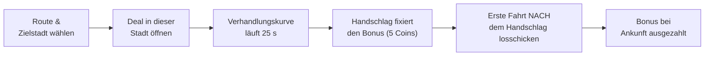

# Deals & Verhandlungen

**Deals** (*Verhandlungen*) sind zeitlich begrenzte Bonus-Verhandlungen
für Lieferungen in bestimmte Städte. Ein erfolgreich verhandelter Deal
gibt einen prozentualen Bonus auf den Grundpreis einer Lieferung in diese
Stadt — bis zum Doppelten des Geldes.

---

## 1. So läuft ein Deal ab

1. **Zuerst die Route wählen**: Wähle Lieferung und Zielstadt, bevor du
   verhandelst. Der Deal ist an diese Stadt gebunden.
2. **Verhandlungsfenster**: Die Kurve läuft **25 Sekunden**. Wo du sie
   stoppst, bestimmt den eingefrorenen Bonus.
3. **Handschlag**: Der aktuelle Bonus auf den Grundpreis einer Lieferung
   in diese Stadt wird eingefroren und kostet **5 Coins (★)**. Seit
   Version 0.17 wertet der Handschlag den Klick aus, nicht die Ankunft.
4. **Bindung**: Der Deal hängt sich an die **erste Fahrt, die du nach
   dem Handschlag in diese Stadt losschickst** — eine schon rollende
   Fahrt bekommt ihn nicht.
5. **Garantie**: Diese Fahrt behält den Deal bis zur Ankunft, egal wie
   viele LKW dasselbe Ziel ansteuern und wer zuerst ankommt.
6. **Auszahlung**: Der Bonus wird bei Ankunft der gebundenen Fahrt auf
   den Grundpreis der Lieferung aufgeschlagen.

---

## 2. Übersicht, Stornierung & Ablauf

* **Reiter „Angenommen"**: Zeigt, welcher deiner LKW den Deal gerade
  einfährt.
* **Fahrt abbrechen** und der Deal wird wieder frei für eine andere Fahrt.
* **Ablauf**: Ohne neue Fahrt dorthin verfällt der Deal nach einer Weile.
  Ein Deal gilt pro Stadt nur einmal: Ein neuer Deal für dieselbe Stadt
  ist erst nach Ankunft der gebundenen Fahrt oder nach Ablauf möglich und
  muss innerhalb seiner Frist genutzt werden.

---

## 3. Deal-Qualität & Verfügbarkeit

Ob ein Deal niedrig, mittel oder hoch ausfällt, hängt von der **Zielstadt
und der Anzahl der Aufträge dorthin** ab. In der Regel sind nur **10–20 %**
der verfügbaren Deals hoch.

---

## 4. Anbindung an die Frachtenbörse (seit 0.17)

* Auftragslisten in der [Frachtenbörse](./freight-exchange.md) zeigen
  **direkte Deal-Indikatoren**.
* Aktive Deals bieten **Schnell-Links** in die Frachtenbörsen-Suche für
  diese Stadt.
