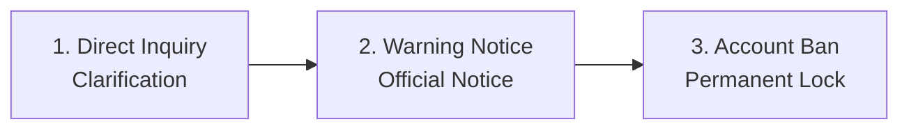

# Economy & Fair-Play Guidelines

This guide details the economic rules, anti-cheat policies, and Terms of
Service (TOS/AGB) governing VoltFracht.

---

## 1. Legal Nature of In-Game Currency ("€" & Coins)

Section 2 of the VoltFracht Terms & Conditions (T&C) explicitly defines the
legal status of all in-game assets and financial balances:

* **Purely Virtual ("Funny Money")**: All in-game Euro balances ("€"), Coins
  (★), vehicles, orders, and haulage assets are strictly virtual points with
  **no real monetary value**.
* **No Real-World Payouts**: Virtual Euros and Coins cannot be cashed out,
  refunded, or exchanged for real-world currency, legal tender, or physical
  goods.
* **Digital Content Terms**: Optional purchases (such as VoltFracht PRO or
  Coin packages) grant immediate digital usage rights. Per Section 3 of the
  TOS (§ 356(5) BGB), performance begins immediately upon purchase and holds
  no right of withdrawal or cash conversion.

---

## 2. In-Game Economy & Score Balancing

To maintain competitive integrity across international leaderboards:

* **No Currency Conversion**: In-game Coins (★) cannot be converted into
  virtual Euro (€) cash balance. Implemented 30 September 2026 to prevent
  pay-to-win ranking exploitation.
* **Depot Upgrade Cap**: Upgrading depot capacity via Coins is capped at
  Depot Level 8. Depot slots from Level 9 onwards must be funded through
  earned freight revenue to prevent pay-to-win advantages on public
  rankings. Implemented 30 September 2026.

**Rationale**: These economic adjustments were introduced after analysis
revealed that unlimited Coin-to-Euro conversion and depot expansion allowed
purchasing ranking positions rather than earning them through gameplay. All
existing bookings were verified (79'000+ transactions audited). Coin
calculations were always correct; only the conversion pathway was removed.

---

## 3. Used Truck Marketplace Anti-Abuse Rules

To stop artificial money transfers between secondary accounts, trading on
the used truck marketplace is restricted by automated safeguards
implemented 26 September 2026:

| Anti-Abuse Rule | Enforcement Limit | Purpose |
| :--- | :--- | :--- |
| **Account Level Gate** | Level 3 required | Prevents instant throwaway account creation for price exploitation. |
| **Price Bounds** | Min: Instant-sell value Max: 1.2x new vehicle price | Prevents selling starter trucks at fantasy prices to transfer virtual cash. Previously, prices could be set up to 10x new vehicle price, enabling exploitation loops. |
| **Daily Partner Cap** | Max 3 trades/day per trading partner | Blocks continuous circular trading loops between affiliated accounts. |

**Context**: These rules were introduced after detecting an exploitation
scheme where players created new accounts, collected starting capital,
purchased vehicles from their main account at inflated prices, sold them
back cheaply, then discarded the temporary account. The affected accounts
were identified, illicit gains were recovered, and the accounts were removed
from top rankings. Primary account and 21 throwaway accounts were banned.

---

## 4. Terms of Service (AGB) & Anti-Cheat Policies

VoltFracht enforces clear fair-play guidelines to ensure all leaderboard
rankings reflect genuine human dispatching skill.

**Note**: With version 0.18 (released 18 October 2026), a new fair-play section
was added to the AGB requiring all players to accept the updated terms upon
next login. These rules apply from the date of player consent, not
retroactively.

### The "You Play Yourself" Principle

Every dispatch action, including selecting cargo, routing trucks, and
setting charging stops, must be manually initiated by the account owner.
Prohibited automation tools include:

* Automated scripts, bots, macros, and auto-clickers.
* Interfacing with the server API outside the official web/mobile client.

**Rationale**: Developer analysis of leaderboard data revealed accounts
operating 24/7 without pauses, indicating either shared credentials or
automated scripts. Both violate the spirit of fair competition.

### Account Ownership

* **Single-User Ownership**: Accounts belong strictly to a single
  individual.
* **Prohibited Sharing**: Account sharing, joint multi-person play, renting,
  selling, or transferring credentials is forbidden.

**Clarification**: These rules do not restrict how often you play or on how
many of your own devices you access your account. They only prohibit a
single account from achieving more than one human could reasonably
accomplish.

### Audit & Dispute Procedure

To catch round-the-clock automated accounts fairly, the developer logs
action timestamps only (without IP or hardware tracking) for 90 days in
accordance with the privacy policy.

1. **Inquiry**: Players flagged for inhuman activity (e.g. 24/7 operation
   without breaks) receive a direct in-game clarification question first.
2. **Warning**: Continued unverified automation after inquiry results in a
   formal warning.
3. **Ban**: Persistent violations lead to account suspension and removal
   from leaderboard rankings.

**Important**: No account will be banned without prior inquiry. The first
notification you receive will be a question, not a punishment.

---

## 5. Financial Transparency & Receipt Tracking

Every financial transaction in VoltFracht generates an itemised booking
receipt with a unique receipt number (`Belegnummer`), allowing dispatchers
to verify income, PRO bonus additions, and coin distributions directly in
the transaction log. This system supports the fair-play audit process by
providing traceable financial records.
