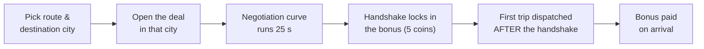

# Deals & City Negotiations

**Deals** (*Verhandlungen*) are time-limited bonus negotiations for
deliveries into specific cities. A successfully negotiated deal adds a
percentage bonus on top of the base payout of a delivery into that city —
up to double the money.

---

## 1. How a Deal Works

1. **Choose your route first**: Select the delivery and its destination
   city before negotiating. The deal is tied to that city.
2. **Negotiation window**: The curve runs for **25 seconds**. Where you
   stop it determines the locked-in bonus.
3. **Handshake**: Locking in the current bonus on the base price of a
   delivery into that city costs **5 Coins (★)**. Since version 0.17 the
   handshake evaluates the click, not the arrival.
4. **Binding**: The deal attaches to the **first trip you dispatch to
   that city after the handshake** — a trip already rolling does not get
   it.
5. **Guarantee**: That trip keeps the deal until it arrives, no matter
   how many trucks share the destination or who arrives first.
6. **Payout**: The bonus is paid on top of the delivery's base price when
   the bound trip arrives.

---

## 2. Tracking, Cancelling & Expiry

* **Accepted tab**: Shows which of your trucks is currently bringing in
  the deal.
* **Cancel the trip** and the deal becomes free again for another trip.
* **Expiry**: With no new trip heading there, the deal expires after a
  while. A deal is valid only once per city: a new deal for the same city
  can only be negotiated after the bound trip has arrived or the deal has
  expired, and it must be used within its time limit.

---

## 3. Deal Quality & Availability

Whether a deal comes out low, medium, or high depends on the **destination
city and the number of orders going there**. Typically only **10–20 %** of
the available deals fall into the high range.

---

## 4. Freight Exchange Integration (since 0.17)

* Job listings on the [freight exchange](./freight-exchange.md) show
  **direct deal indicators**.
* Active deals offer **quick links** into the freight exchange search for
  that city.
